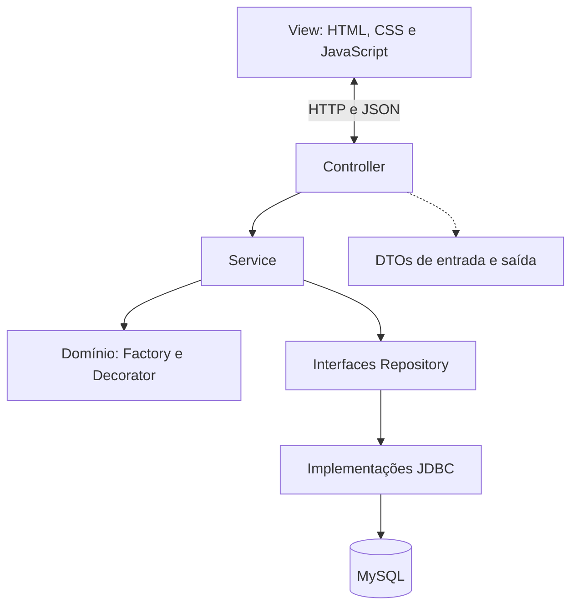
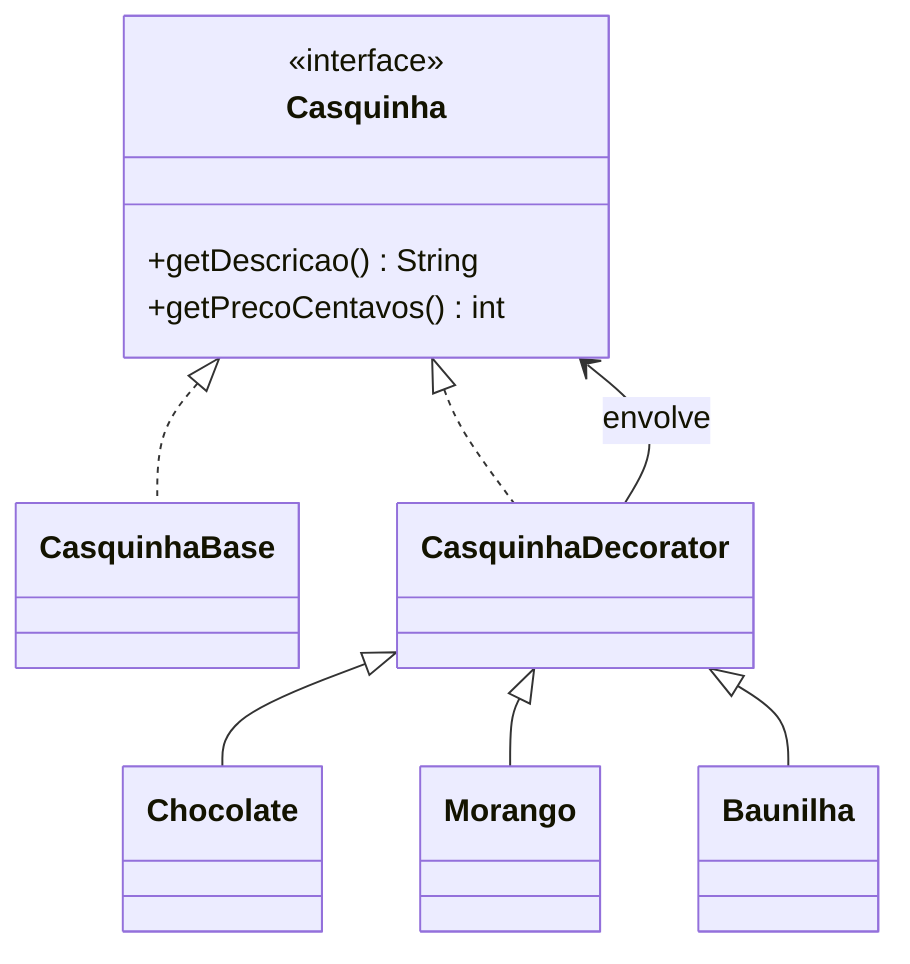
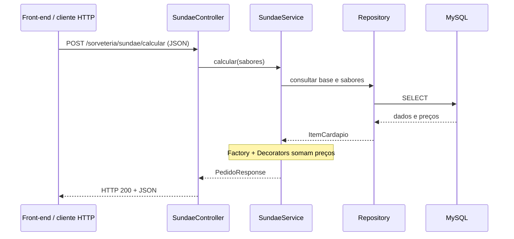

# 🍦 Sorveteria | API REST em Java

Aplicação web para consultar o cardápio, montar sundaes personalizados, simular preços, registrar pedidos e cadastrar clientes. O projeto explora a aplicação de padrões de projeto e orientação a objetos em uma arquitetura web com Spring Boot e persistência relacional.

O **back-end é a fonte de verdade** para os preços e as regras de negócio. O front-end envia identificadores dos sabores e apresenta o resultado calculado pelo servidor.

> **Status:** projeto acadêmico/de estudo, destinado a desenvolvimento local. Não é uma aplicação homologada para produção. A seção [CRUD de sabores](#crud-de-sabores-versão-estendida) descreve a versão estendida com `SaborController` e `SaborDinamico`; essas classes precisam estar presentes no código executado para que suas rotas funcionem.

## Sumário

- [Funcionalidades](#funcionalidades)
- [Tecnologias](#tecnologias)
- [Arquitetura](#arquitetura)
- [Padrões de projeto e orientação a objetos](#padrões-de-projeto-e-orientação-a-objetos)
- [Execução local](#execução-local)
- [Contrato da API](#contrato-da-api)
- [CRUD de sabores — versão estendida](#crud-de-sabores-versão-estendida)
- [Integração com o front-end](#integração-com-o-front-end)
- [Persistência](#persistência)
- [Testes](#testes)
- [Segurança e limitações](#segurança-e-limitações)
- [Diagramas](#diagramas)

## Funcionalidades

- Consultar a casquinha base e os sabores cadastrados no MySQL.
- Montar um sundae por composição de decorators e calcular seu preço.
- Simular o total sem persistir o pedido.
- Finalizar um pedido e registrar seus sabores em uma transação.
- Cadastrar clientes, validar CPF e telefone e verificar duplicidade de CPF.
- Na versão estendida: cadastrar, consultar, editar e excluir sabores pela interface administrativa, sem criar uma classe Java por novo sabor.

## Tecnologias

| Camada | Tecnologia |
|---|---|
| Front-end | HTML5, CSS e JavaScript puro (`fetch`) |
| Back-end | Java 24, Spring Boot 4 (versão 4.1.2 declarada no `pom.xml`), Spring MVC |
| Build | Maven Wrapper |
| Persistência | MySQL, Spring JDBC (`JdbcTemplate`) |
| Contratos | HTTP e JSON, DTOs com Java `record` |
| Testes | JUnit 5, Spring Boot Test; Mockito para testes isolados de serviços quando disponível |

## Arquitetura

O projeto utiliza Spring MVC e uma organização em camadas. A interface web é servida pelo próprio Spring Boot; os controllers REST fornecem dados em JSON, enquanto `PaginaController` encaminha as requisições de página para os arquivos HTML.



| Pacote | Responsabilidade |
|---|---|
| `controller` | Mapeia rotas HTTP, recebe DTOs e delega aos serviços. |
| `service` | Coordena casos de uso, regras de negócio e transações. |
| `model` | Representa o domínio: casquinha, cliente, CPF e itens do cardápio. |
| `model.decorator` | Compõe sabores sobre a casquinha. |
| `repository` | Contratos e implementações de acesso ao banco. |
| `dto` | Define a estrutura de dados que entra e sai da API. |
| `exception` | Exceções de negócio. |
| `config` | Configurações do Spring, incluindo CORS. |

### Organização dos arquivos

Após extrair o ZIP, localize a pasta que contém simultaneamente `front-end` e `back-end`.

```text
SorveteriaJAVA/
├── back-end/
│   ├── pom.xml
│   ├── mvnw / mvnw.cmd
│   └── src/
│       ├── main/
│       │   ├── java/com/example/backend/
│       │   │   ├── controller/
│       │   │   ├── dto/
│       │   │   ├── exception/
│       │   │   ├── model/decorator/
│       │   │   ├── repository/
│       │   │   ├── service/
│       │   │   └── config/
│       │   └── resources/application.properties
│       └── test/java/com/example/backend/
├── front-end/
│   ├── index.html
│   ├── css/style.css
│   └── javascript/
│       ├── api.js
│       └── app.js
├── Banco de dados.sql
├── Untitled-2.sql
└── Olhar os pedidos.sql
```

A versão estendida inclui `sabores.html`, `javascript/sabores.js`, `SaborController`, `SaborService`, `SaborRequest`, `SaborRepository`, `SaborRepositoryJdbc` e `SaborDinamico`.

## Padrões de projeto e orientação a objetos

### Decorator: composição de sabores

`Casquinha` é a abstração comum. `CasquinhaBase` representa o componente concreto. `CasquinhaDecorator` envolve uma instância de `Casquinha`; os decorators concretos acrescentam descrição e preço ao objeto envolvido.



Exemplo com os preços iniciais do banco:

```text
Morango (+200 centavos)
└── Chocolate (+200 centavos)
    └── CasquinhaBase (500 centavos)

Total: 900 centavos = R$ 9,00
```

`SundaeService.montar()` começa pela base, consulta cada sabor pelo ID e usa `CasquinhaFactory.adicionarSabor()` para envolver o objeto anterior. O resultado é uma cadeia de objetos que compartilham a interface `Casquinha`.

Na implementação original, a fábrica contém um mapa de sabores conhecidos. Adicionar um sabor exige registrá-lo no mapa e implementar seu decorator. Na versão estendida, `SaborDinamico` é utilizado quando não existe um decorator específico, permitindo que sabores registrados no banco sejam usados sem alterar a fábrica novamente.

### Outros padrões e princípios

- **Factory:** centraliza a criação da base e a escolha do decorator.
- **Repository/DAO:** isola o SQL e a infraestrutura JDBC das regras de negócio.
- **DTO:** separa o contrato HTTP da representação interna do domínio.
- **Injeção por construtor:** explicita dependências e facilita a substituição por objetos simulados nos testes.
- **Value Object:** `Cpf` encapsula a validação e a formatação do documento.

| SOLID | Evidência e ressalva |
|---|---|
| S — Responsabilidade única | Controllers, serviços e repositórios possuem papéis distintos; há oportunidades de separar validações e mapeamentos. |
| O — Aberto/fechado | Decorators permitem composição. A fábrica original exige alterações para novos sabores; a versão dinâmica reduz esse acoplamento. |
| L — Substituição de Liskov | Base e decorators implementam o contrato `Casquinha`; testes de comportamento ajudam a verificar sua substituibilidade. |
| I — Segregação de interfaces | Contratos específicos de persistência; na versão estendida, leitura e escrita de sabores são separadas. |
| D — Inversão de dependência | Serviços recebem interfaces de repositórios e `NumeradorPedido` por construtor. Nem toda dependência está abstraída. |

O projeto utiliza encapsulamento, abstração, herança e polimorfismo. A Calistenia de Objetos é aplicada parcialmente: objetos pequenos, ausência de setters em records e encapsulamento do CPF são exemplos. Existem violações ou exceções às regras estritas, como o uso de `else`, encadeamento de métodos, tipos primitivos e serviços com mais de duas dependências. Não se declara conformidade integral com SOLID ou Calistenia de Objetos.

## Execução local

### 1. Pré-requisitos e download

- JDK 24, com `JAVA_HOME` configurado.
- MySQL 8+ em execução.
- Terminal ou IntelliJ IDEA; internet para baixar dependências Maven.

```bash
git clone https://github.com/MarioOtavio24/Sorveteria.git
cd Sorveteria
```

O repositório disponibiliza o código em ZIP. Extraia `SorveteriaJAVA 1.0.zip` e navegue até a pasta `SorveteriaJAVA` que contém os dois diretórios do aplicativo. Se estiver utilizando a versão estendida, extraia o ZIP correspondente em vez do original.

### 2. Banco de dados

No MySQL Workbench, execute `Banco de dados.sql` uma vez, em um ambiente de desenvolvimento novo. O script cria o schema `sorveteria`, tabelas e dados iniciais. Ele não é idempotente: não o execute novamente indiscriminadamente em uma base existente.

Execute também a criação da restrição de unicidade de CPF presente em `Untitled-2.sql`, uma única vez, após verificar que não existem CPFs duplicados:

```sql
USE sorveteria;
ALTER TABLE Clientes ADD CONSTRAINT uk_clientes_cpf UNIQUE (CPF);
```

Essa restrição protege contra cadastros concorrentes com o mesmo CPF. O script principal, sozinho, não a cria.

### 3. Configuração

Edite `back-end/src/main/resources/application.properties` para manter credenciais fora do código-fonte:

```properties
spring.application.name=back-end
server.port=8080
spring.datasource.url=jdbc:mysql://localhost:3306/sorveteria?serverTimezone=America/Sao_Paulo
spring.datasource.username=${DB_USER:root}
spring.datasource.password=${DB_PASSWORD}
```

O trecho acima é uma configuração recomendada; ajuste o arquivo local caso ele ainda não utilize as variáveis de ambiente. Use um usuário de banco com privilégios mínimos sempre que possível. Configure `DB_USER` e `DB_PASSWORD` na IDE ou no ambiente do terminal, sem publicar seus valores.

### 4. Inicie o back-end

No Windows (PowerShell):

```powershell
cd back-end
.\mvnw.cmd spring-boot:run
```

No Linux/macOS:

```bash
cd back-end
chmod +x mvnw
./mvnw spring-boot:run
```

Alternativamente, abra o `pom.xml` no IntelliJ IDEA e execute `BackEndApplication.java`.

O Maven copia os recursos de `../front-end` para `static` no build. Mantenha as duas pastas lado a lado.

### 5. Acesse a aplicação

| Recurso | Endereço local |
|---|---|
| Interface de pedidos (HTML) | <http://localhost:8080/sorveteria> |
| Cardápio (JSON) | <http://localhost:8080/sorveteria/sabores> |
| Gestão de sabores (HTML; versão estendida) | <http://localhost:8080/sorveteria/gerenciar> |

`localhost` significa o próprio computador onde o cliente HTTP está sendo executado. O GitHub hospeda o código, não o servidor Spring Boot. Não use a URL do GitHub como endereço da API.

## Contrato da API

**Origem local:** `http://localhost:8080`  
**Prefixo das rotas:** `/sorveteria`  
**Formato dos dados:** JSON  
**Autenticação:** não implementada; uso restrito a ambiente local confiável.

### Anatomia de uma requisição

Uma requisição HTTP possui um método, uma URL, cabeçalhos e, quando necessário, um corpo. O corpo (*request body*) contém os dados enviados pelo cliente, não o código Java nem comandos SQL.

```http
POST /sorveteria/sundae/calcular HTTP/1.1
Host: localhost:8080
Content-Type: application/json
Accept: application/json

{"sabores":["chocolate","morango"]}
```

`Content-Type` informa o formato do corpo enviado. `Accept` informa o formato desejado da resposta. A linha vazia separa os cabeçalhos do corpo. O Spring desserializa o JSON em `PedidoRequest` por meio de `@RequestBody`; o retorno `PedidoResponse` é serializado em JSON.



### Endpoints da versão original

| Método | Rota | Sucesso | Efeito |
|---|---|---|---|
| GET | `/sorveteria/sabores` | 200 OK | Consulta base e sabores; não grava. |
| POST | `/sorveteria/sundae/calcular` | 200 OK | Simula o total; não grava. |
| POST | `/sorveteria/pedidos` | 201 Created | Persiste o pedido e seus itens. |
| POST | `/sorveteria/clientes` | 201 Created | Cadastra um cliente. |

Os exemplos abaixo são ilustrativos, baseados no código e nos preços iniciais do SQL. Valores, IDs e ordem da lista podem variar conforme os dados armazenados. Não são respostas coletadas de um servidor executado.

### GET /sorveteria/sabores — consultar o cardápio

Sem corpo. Pode ser aberto no navegador, no Postman ou pelo terminal:

```bash
curl -i http://localhost:8080/sorveteria/sabores
```

Resposta esperada: `200 OK`.

```json
{
  "nomeBase": "Casquinha",
  "precoBase": 5.00,
  "sabores": [
    {"id": "baunilha", "nome": "Baunilha", "emoji": "🍨", "preco": 2.00},
    {"id": "chocolate", "nome": "Chocolate", "emoji": "🍫", "preco": 2.00},
    {"id": "morango", "nome": "Morango", "emoji": "🍓", "preco": 2.00}
  ]
}
```

O DTO `CardapioResponse` contém a base e uma lista de `SaborResponse`. O campo `preco` representa o adicional em reais, não em centavos. Use o campo `id` de cada sabor nas próximas chamadas, e não seu nome de exibição.

### POST /sorveteria/sundae/calcular — simular preço

Corpo (`PedidoRequest`):

```json
{"sabores": ["chocolate", "morango"]}
```

| Campo | Tipo | Regra |
|---|---|---|
| `sabores` | array de strings | Identificadores existentes no cardápio; repetidos são removidos. |

A implementação atual normaliza uma lista vazia ou nula para uma casquinha sem sabores. Não aceita IDs inexistentes. Na versão original, os sabores também precisam estar registrados na fábrica.

```bash
curl -i -X POST http://localhost:8080/sorveteria/sundae/calcular \
  -H 'Content-Type: application/json' \
  -d '{"sabores":["chocolate","morango"]}'
```

Resposta esperada: `200 OK`.

```json
{"id": null, "sabores": ["chocolate", "morango"], "total": 9.00}
```

`id` é nulo porque não houve registro de pedido. O total vem da base e dos preços consultados no servidor. O cálculo não reserva preços nem estoque.

### POST /sorveteria/pedidos — finalizar pedido

Utiliza o mesmo `PedidoRequest` da simulação.

```bash
curl -i -X POST http://localhost:8080/sorveteria/pedidos \
  -H 'Content-Type: application/json' \
  -d '{"sabores":["chocolate","morango"]}'
```

Resposta esperada: `201 Created`.

```json
{"id": 1, "sabores": ["chocolate", "morango"], "total": 9.00}
```

O serviço recalcula o total e grava `Pedido` e `ItemPedido` na mesma transação. O campo `id` dessa resposta representa **o número gerado pelo `NumeradorEmMemoria`**, e não necessariamente a chave primária `Pedido.id` do MySQL. Essa numeração reinicia ao reiniciar a aplicação. Não existe uma rota de consulta de pedidos por esse número no código analisado.

Cada chamada de finalização pode criar um novo pedido. A operação não implementa idempotência. Não repita automaticamente um POST cujo resultado seja desconhecido após uma falha de rede.

### POST /sorveteria/clientes — cadastrar cliente

Exemplo de corpo (`ClienteRequest`), usando dados de demonstração:

```json
{
  "nome": "Cliente de Teste",
  "cpf": "529.982.247-25",
  "telefone": "(11) 99999-9999",
  "endereco": "Rua de Teste, 10"
}
```

| Campo | Tipo | Validação |
|---|---|---|
| `nome` | string | Obrigatório, até 80 caracteres. |
| `cpf` | string | 11 dígitos após normalização, com dígitos verificadores válidos; não pode estar cadastrado. |
| `telefone` | string | 10 ou 11 dígitos após remover a formatação. |
| `endereco` | string | Obrigatório, até 60 caracteres. |

Resposta esperada: `201 Created` (`ClienteResponse`).

```json
{
  "id": 1,
  "nome": "Cliente de Teste",
  "cpf": "529.982.247-25",
  "endereco": "Rua de Teste, 10",
  "telefone": "11999999999"
}
```

CPF inválido ou outros dados inválidos geram `400 Bad Request`; CPF já cadastrado gera `409 Conflict`. A resposta contém dados pessoais: não utilize dados de clientes reais para demonstrações públicas. Cadastrar um cliente não associa automaticamente um pedido a ele; o contrato atual de `PedidoRequest` não inclui `idCliente`.

### DTOs

| DTO | Direção | Campos |
|---|---|---|
| `CardapioResponse` | Saída | `nomeBase`, `precoBase`, `sabores` |
| `SaborResponse` | Saída | `id`, `nome`, `emoji`, `preco` |
| `PedidoRequest` | Entrada | `sabores` |
| `PedidoResponse` | Saída | `id`, `sabores`, `total` |
| `ClienteRequest` | Entrada | `nome`, `cpf`, `telefone`, `endereco` |
| `ClienteResponse` | Saída | `id`, `nome`, `cpf`, `endereco`, `telefone` |
| `ErroResponse` | Saída | `erro` |
| `SaborRequest` (estendida) | Entrada | `nome`, `emoji`, `preco` |

### Erros HTTP

| Status | Significado / situação |
|---|---|
| 400 Bad Request | Sabor inexistente no pedido, dados inválidos ou JSON malformado. |
| 404 Not Found | URL inexistente; na versão estendida, sabor administrativo não encontrado. |
| 405 Method Not Allowed | Método HTTP não suportado para a rota. |
| 409 Conflict | CPF duplicado; na versão estendida, exclusão de sabor vinculado a pedidos ou estoque. |
| 415 Unsupported Media Type | Corpo enviado em formato não suportado, por exemplo `text/plain` no lugar de JSON. |
| 500 Internal Server Error | Falha inesperada, por exemplo indisponibilidade do banco. Investigue logs no servidor. |

Exemplo de erro de negócio tratado por `ApiExceptionHandler`:

```json
{"erro": "Sabor inválido: inexistente"}
```

Esse formato é usado pelas exceções específicas tratadas no código. Erros do próprio Spring e `ResponseStatusException` (CRUD estendido) podem ter outra estrutura. O consumidor deve verificar o status HTTP e não assumir que todo erro possui o campo `erro`.

### Uso correto e incorreto

| Faça | Evite |
|---|---|
| Use `GET /sabores` para obter IDs e preços. | Enviar nomes de exibição ou IDs inventados. |
| Use POST com JSON para calcular e finalizar. | Abrir a rota POST na barra de endereços, que normalmente faz GET. |
| Envie `{"sabores":["chocolate"]}`. | Enviar `{"sabores":"chocolate"}` ou uma lista de objetos. |
| Envie somente os campos do DTO. | Enviar um `total` definido pelo cliente; não é parte do contrato e não controla o cálculo. |
| Use `/sundae/calcular` para visualizar o total. | Usar `/pedidos` como simulação, pois grava dados. |
| Use `/sorveteria/...` como prefixo. | Usar `/api/...` apenas porque comentários antigos mencionam esse caminho. |
| Use `Content-Type: application/json`. | Enviar texto sem aspas, vírgulas finais ou formulário como se fosse JSON. |

As rotas da tabela são relativas ao prefixo `/sorveteria`, exceto quando o caminho completo é apresentado.

### Como testar no Postman

1. Inicie o MySQL e a aplicação Spring Boot.
2. Crie uma requisição GET para `http://localhost:8080/sorveteria/sabores` e clique em **Send**. Confira o status 200 e os IDs retornados.
3. Crie uma requisição POST para `http://localhost:8080/sorveteria/sundae/calcular`.
4. Em **Body**, escolha **raw → JSON**, cole `{"sabores":["chocolate","morango"]}` e envie. Confira o cabeçalho `Content-Type: application/json` e o retorno 200.
5. Troque um ID por `inexistente` para observar o erro 400. Envie novamente os IDs corretos.
6. Somente quando desejar gravar um pedido de teste, mude a URL para `/sorveteria/pedidos` e confirme o retorno 201.

No Windows PowerShell, para evitar diferenças de escape entre shells, uma opção equivalente para cálculo é:

```powershell
$body = @{ sabores = @('chocolate', 'morango') } | ConvertTo-Json
Invoke-RestMethod -Method Post -Uri 'http://localhost:8080/sorveteria/sundae/calcular' -ContentType 'application/json' -Body $body
```

## CRUD de sabores — versão estendida

> Esta seção se aplica somente à versão com `SaborController`, `SaborService`, `SaborRepository` e `SaborDinamico`. Se estiver usando o ZIP original, essas rotas ainda não existem.

Interface: <http://localhost:8080/sorveteria/gerenciar>.

| Método | Rota | Sucesso |
|---|---|---|
| GET | `/sorveteria/gerenciar/sabores` | 200 — lista de sabores |
| GET | `/sorveteria/gerenciar/sabores/{id}` | 200 — sabor individual |
| POST | `/sorveteria/gerenciar/sabores` | 201 — novo sabor |
| PUT | `/sorveteria/gerenciar/sabores/{id}` | 200 — sabor atualizado |
| DELETE | `/sorveteria/gerenciar/sabores/{id}` | 204 — sem corpo |

### Criar um sabor (Pistache)

```http
POST /sorveteria/gerenciar/sabores
Content-Type: application/json
```

```json
{"nome": "Pistache", "emoji": "🌰", "preco": 3.50}
```

`SaborRequest`: nome obrigatório de até 90 caracteres; emoji opcional de até 10 pontos de código Unicode; preço obrigatório, não negativo, sem fração de centavo e dentro do limite do `int` usado em centavos. O nome não é uma chave única.

Exemplo de resposta 201 (ID ilustrativo):

```json
{"id": "0123456789abcdef0123456789abcd", "nome": "Pistache", "emoji": "🌰", "preco": 3.50}
```

O ID é gerado pelo servidor (UUID sem hífens, truncado para 30 caracteres). Guarde o ID efetivamente retornado; não presuma que seja `pistache`.

### Consultar, editar e excluir

Consulte a lista administrativa com GET, sem corpo, e copie o ID real. Para edição, utilize PUT com os campos completos do DTO; o ID da URL é mantido.

```http
PUT /sorveteria/gerenciar/sabores/0123456789abcdef0123456789abcd
Content-Type: application/json
```

```json
{"nome": "Pistache Premium", "emoji": "🌰", "preco": 4.00}
```

Para exclusão, utilize DELETE com o ID real e sem corpo. Sabores referenciados em `ItemPedido` ou `Estoque` não podem ser removidos pelas restrições de chave estrangeira; a API retorna 409. Um ID inexistente retorna 404. Não tente apagar a casquinha base usando o CRUD de sabores.

### Utilizar um sabor cadastrado em um pedido

Consulte novamente `GET /sorveteria/sabores` e envie o ID retornado ao endpoint de cálculo. Exemplo imediatamente após criar Pistache por R$ 3,50, antes da edição de preço acima:

```json
{"sabores": ["0123456789abcdef0123456789abcd"]}
```

Com a base inicial de R$ 5,00, o total esperado é R$ 8,50. O serviço primeiro valida a existência do sabor no cardápio, depois a fábrica usa o decorator dinâmico. Não é necessário implementar `Pistache.java`.

## Integração com o front-end

`app.js` controla a interface e usa as funções de `api.js`. O modo `USAR_DADOS_SIMULADOS = false` ativa a comunicação real com o servidor. O modo simulado não persiste pedidos no banco.

Exemplo independente de uso de `fetch`:

```javascript
async function calcular(sabores) {
    const resposta = await fetch('/sorveteria/sundae/calcular', {
        method: 'POST',
        headers: { 'Content-Type': 'application/json' },
        body: JSON.stringify({ sabores })
    });
    if (!resposta.ok) {
        const erro = await resposta.json().catch(() => ({}));
        throw new Error(erro.erro || `HTTP ${resposta.status}`);
    }
    return resposta.json();
}
```

`JSON.stringify()` converte o objeto JavaScript no corpo JSON; `resposta.json()` converte o JSON recebido em objeto JavaScript. Em endpoints DELETE com status 204 não tente interpretar um corpo inexistente.

O código original de `api.js` usa URL absoluta para `localhost:8080`; prefira URL relativa se a página e a API forem servidas na mesma origem, para evitar problemas em outras máquinas. O `WebConfig` atual mapeia CORS em `/api/**`, enquanto as rotas reais usam `/sorveteria/**`. Isso não impede a comunicação na mesma origem, mas precisa ser corrigido antes de servir o front-end em outra origem. Para o CRUD, permita também PUT e DELETE, com origens explicitamente autorizadas. CORS não substitui autenticação nem autorização.

## Persistência

| Tabela | Papel |
|---|---|
| `ItemCardapio` | Base e sabores, com preços em centavos inteiros. |
| `Clientes` | Dados cadastrais do cliente. |
| `Pedido` | Identificador do banco, número, total e data do pedido. |
| `ItemPedido` | Relação entre pedido e sabores selecionados. |
| `Pagamento` | Estrutura prevista para pagamentos; não há endpoint de pagamento no código analisado. |
| `Estoque` | Estrutura de estoque; não há fluxo de baixa automática no serviço de pedidos analisado. |

`JdbcTemplate` executa consultas parametrizadas nos repositórios. Os preços são manipulados em centavos e convertidos para `BigDecimal` em reais na API. A anotação `@Transactional` na finalização protege a atomicidade das inserções de pedido e itens. A base é incluída no total, mas o repositório insere em `ItemPedido` apenas os IDs dos sabores selecionados.

Consulta de verificação (somente leitura):

```sql
USE sorveteria;
SELECT id, numero, total_centavos, data_pedido FROM Pedido;
SELECT id_pedido, id_item FROM ItemPedido;
```

## Testes

No diretório `back-end`:

```bash
./mvnw test
```

Windows: `.\mvnw.cmd test`.

| Classe | Objetivo |
|---|---|
| `ChocolateTest` | Validar o decorator de chocolate. |
| `MorangoTest` | Validar o decorator de morango. |
| `BaunilhaTest` | Validar o decorator de baunilha. |
| `CasquinhaCenariosTest` | Validar composição e cenários de sucesso/erro da fábrica original. |
| `BackEndApplicationTests` | Verificar carregamento do contexto Spring. |

Para executar apenas testes de domínio, sem subir o contexto Spring:

```bash
./mvnw -Dtest=ChocolateTest,MorangoTest,BaunilhaTest,CasquinhaCenariosTest test
```

Na versão estendida, atualize o teste antigo que espera uma exceção da fábrica ao adicionar Pistache: um novo sabor fornecido à fábrica agora é aceito pelo decorator dinâmico. Um ID inexistente deve ser rejeitado no serviço, durante a consulta ao repositório.

**Cobertura recomendada adicional:** `SundaeServiceTest` com JUnit e Mockito, exercitando `montar()` indiretamente por `calcular()`; teste de integração REST/JDBC para persistência, validação de clientes, códigos HTTP e CRUD. Cenários: apenas base, múltiplos decorators, IDs repetidos, sabor inexistente e sabor dinâmico. O teste de contexto pode exigir configuração do ambiente e do banco. Nenhum resultado de execução ou percentual de cobertura é afirmado neste documento.

## Segurança e limitações

- Não publique credenciais, CPF real, telefones ou endereços de clientes. Se alguma senha já foi commitada ou publicada em um ZIP, troque-a e remova o segredo também do histórico.
- A API não possui autenticação/autorização; a gestão de sabores não é uma área administrativa protegida. Não exponha o servidor à internet sem implementar controles de acesso, HTTPS e configuração adequada de infraestrutura.
- Utilize uma base de testes separada e um usuário MySQL de privilégios mínimos.
- A simulação não garante o preço futuro; o pedido é recalculado na finalização.
- Não há idempotência de pedidos nem numeração durável da aplicação. Separe explicitamente o identificador persistido do número de apresentação em evolução futura.
- A restrição de CPF único precisa ser aplicada no banco. Não confie exclusivamente na consulta prévia do serviço.
- Recomenda-se evoluir o contrato de erros, aplicar validação uniforme, documentar a API com OpenAPI, adicionar testes automatizados de integração e versionar migrations de banco.
- Recomenda-se publicar o código-fonte diretamente em diretórios no GitHub, em vez de somente em ZIP, para permitir revisão de código, diffs e integração contínua. Exclua `target/`, arquivos locais da IDE e segredos do versionamento.

## Diagramas

Diagramas originais do projeto (podem precisar de revisão para refletir o CRUD e o decorator dinâmico da versão estendida).

### Diagrama de classes


### Diagrama de sequência


